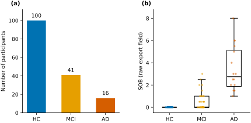
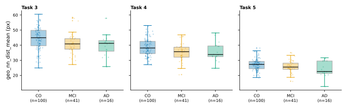
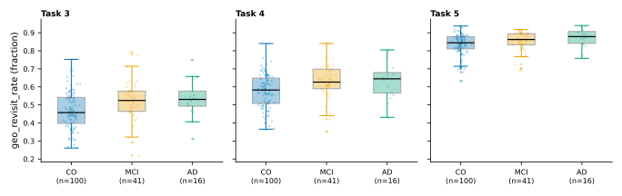
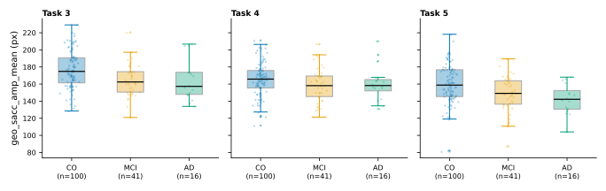
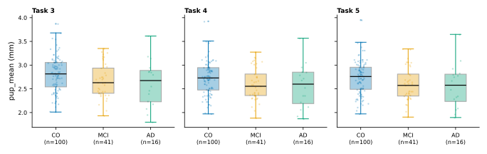
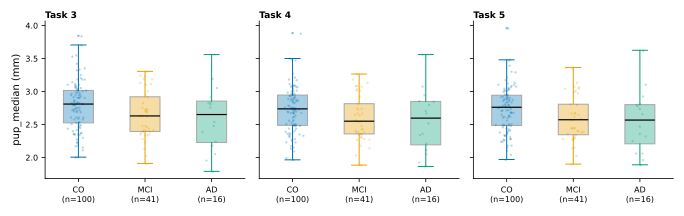
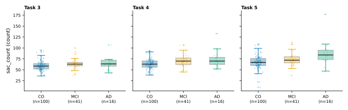
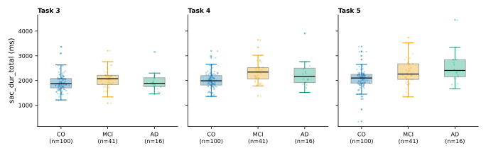
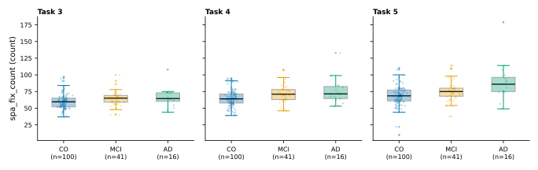

# BEGAD - Báo cáo tuần 1: So sánh giữa các nhóm (CO / MCI / AD)

> Cập nhật 2026-10-13 từ kết quả BEGAD_Norm: baseline có cân bằng lớp (class weights + ngưỡng Youden, CV 5-fold cấp người tham gia × 20 seeds) và hình tổng quan bộ dữ liệu mới (Figure 1).

## 1. Tổng quan bộ dữ liệu

**Cohort.** Phiên 2025-03-05, export tag `BEGAD_ETRA25`, 205 file CSV xuất thô từ máy đo mắt. Chỉ giữ người tham gia lần khám đầu tiên thuộc các nhóm CO / MCI / AD. Đã loại: 36 lần tái khám, 10 người tham gia nhóm NPH (Group 3), 2 bản ghi có Group −11.

| Nhóm | Số người tham gia |
|---|---|
| CO | 100 |
| MCI | 41 |
| AD | 16 |
| **Tổng** | **157** |

**Giao thức.** 11 tác vụ cho mỗi người tham gia (0–10). Tên media đọc từ cột `MediaName` của bản xuất thô; kích thước hình học lấy từ `TASK_GEOMETRY` trong `src/begad_norm/config.py`. Các tác vụ 0, 2, 6, 8, 10 là màn hình hướng dẫn toàn màn hình, không phải stimulus kiểm tra; tác vụ 3–5 là các thẻ King–Devick và tác vụ 9 là tác vụ đọc.

| Tác vụ | Media (`MediaName`) | Kích thước | Mô tả |
|---|---|---|---|
| 0 | `Instruction Element` | 1920×1080 | Màn hình hướng dẫn |
| 1 | `KD_demo_highres.png` | 748×564 | Thẻ King–Devick mẫu (tập thử) |
| 2 | `Instruction Element 2` | 1920×1080 | Màn hình hướng dẫn |
| 3 | `KD_1_highres.png` | 746×566 | Thẻ King–Devick 1 |
| 4 | `KD_2_highres.png` | 744×525 | Thẻ King–Devick 2 |
| 5 | `KD_3_highres.png` | 737×508 | Thẻ King–Devick 3 |
| 6 | `Instruction Element` | 1920×1080 | Màn hình hướng dẫn |
| 7 | `lukeminen_harj.png` | 950×417 | Đọc thử |
| 8 | `Instruction Element` | 1920×1080 | Màn hình hướng dẫn |
| 9 | `lukeminen_1.png` | 918×917 | Tác vụ đọc |
| 10 | `Instruction Element 2` | 1920×1080 | Màn hình hướng dẫn kết thúc |

Bộ dữ liệu đã xử lý chứa 1727 dòng feature (157 × 11; 2 dòng toàn NaN: `BEGCO-029` và `BEGMCI-019`, tác vụ 10).

**Figure 1.** The BEGAD dataset. (a) Participant counts by diagnostic group: healthy controls (HC, n = 100), mild cognitive impairment (MCI, n = 41), and Alzheimer's disease (AD, n = 16); the CO label of the roster is displayed as HC. (b) SOB scores (raw export field) by group (HC n = 100, MCI n = 41, AD n = 16). Boxes show the median and interquartile range (IQR); whiskers extend to the most extreme values within 1.5× the IQR; points show individual participants. Group differences: Kruskal–Wallis H = 104.78, p = 1.8×10⁻²³; pairwise Mann–Whitney U tests with Benjamini–Hochberg correction, all p < 0.001 (HC–MCI p = 1.4×10⁻¹¹; HC–AD p = 3.8×10⁻²⁶; MCI–AD p = 4.4×10⁻⁸). Medians (IQR): HC 0 (0–0), MCI 0 (0–1), AD 2.75 (1.88–5.12). The SOB field is not documented in this repository; its 0.5-step distribution is consistent with a CDR-SOB-like scale (unverified).

Trường SOB là trường dữ liệu thô của máy, chưa được mô tả trong repository này; phân bố theo bước 0.5 phù hợp với thang đo kiểu CDR-SOB (chưa xác minh). Điểm SOB tăng dần theo nhóm (HC đều bằng 0; MCI 0–3; AD 1–8).

## 2. 25 feature được chọn

### Định nghĩa 25 feature

Mỗi feature là một giá trị vô hướng cho mỗi cặp (người tham gia, tác vụ).
Ký hiệu:
- `n` = số fixation sạch;
- `x, y` = tâm fixation (`FixationPointX/Y (MCSpx)`, px, tương đối so với media);
- `dur` = thời lượng fixation (`GazeEventDuration`, ms);
- `pup` = đồng tử trung bình hai mắt `(PupilLeft + PupilRight) / 2` (mm);
- `(cx, cy) = (W/2, H/2)` = tâm media từ `TASK_GEOMETRY` (config.py).
Mọi độ lệch chuẩn dùng `ddof=1` (SD mẫu).

| Feature | Ý nghĩa | Cách tính | Đơn vị |
|---|---|---|---|
| **Pupil - kích thước và động học đồng tử** | | | |
| `pup_mean` | Kích thước đồng tử trung bình trong tác vụ | `mean(pup_i)` với `pup_i = (PupilLeft_i + PupilRight_i) / 2` trên các fixation sạch | mm |
| `pup_median` | Trung vị kích thước đồng tử | `median(pup_i)` | mm |
| `pup_max` / `pup_min` | Kích thước đồng tử lớn nhất / nhỏ nhất | `max` / `min` của chuỗi | mm |
| `pup_std` | Độ biến thiên kích thước đồng tử | SD mẫu (`ddof=1`) của chuỗi | mm |
| `pup_slope` | Xu hướng đồng tử trong tác vụ (dương = giãn, âm = co) | độ dốc đường bình phương tối thiểu (`np.polyfit`, bậc 1) của chuỗi theo thứ tự fixation `0…n−1` | mm trên mỗi chỉ số fixation |
| `pupbl_std` | Độ biến thiên sau hiệu chỉnh baseline | như `pup_std` trên chuỗi đã hiệu chỉnh `((PupilLeft_i − PupilLeftBaseline) + (PupilRight_i − PupilRightBaseline)) / 2` (baseline hằng số theo từng bản ghi) | mm |
| `pupbl_slope` | Xu hướng đồng tử sau hiệu chỉnh baseline | như `pup_slope` trên chuỗi đã hiệu chỉnh | mm trên mỗi chỉ số fixation |
| **Saccade - sự kiện saccade đo được** | | | |
| `sac_count` | Số saccade | `m` = số run saccade | count |
| `sac_dur_total` | Tổng thời gian trong saccade | tổng thời lượng các run | ms |
| `sac_dur_mean` | Thời lượng saccade trung bình | trung bình thời lượng các run | ms |
| `sac_dur_max` | Saccade dài nhất | max thời lượng các run | ms |
| `sac_amp_mean` | Biên độ saccade trung bình | trung bình `SaccadicAmplitude` theo từng fixation | deg (góc nhìn) |
| `sac_amp_std` | Độ biến thiên biên độ saccade | SD mẫu (`ddof=1`) của các biên độ đó | deg |
| `sac_turn_std` | Độ biến thiên hướng chuyển giữa các saccade liên tiếp | SD mẫu (`ddof=1`) của `min(reldir, 360 − reldir)` từ `RelativeSaccadicDirection`, gập về `[0, 180]` | deg |
| **Spatial - vị trí và độ tản fixation** | | | |
| `spa_fix_count` | Số fixation | `n` = fixation sạch còn lại sau khi lọc | count |
| `spa_center_dist_std` | Độ tản của fixation quanh tâm media | SD mẫu (`ddof=1`) của khoảng cách `sqrt((x−cx)² + (y−cy)²)` | px |
| `spa_dispersion` | Khoảng cách trung bình của fixation tới tâm khối (centroid) của chúng | `mean(sqrt((x−mean(x))² + (y−mean(y))²))` | px |
| `spa_q2` | Tỷ lệ fixation ở góc phần tư q2 (bên phải tâm, nửa trên) | tỷ lệ fixation có `x ≥ cx` và `y < cy` | tỷ lệ 0–1 |
| **Geometry - hình dạng scanpath** | | | |
| `geo_scanpath_len` | Tổng chiều dài scanpath | tổng các bước `amp = sqrt(dx² + dy²)`, `dx = diff(x)`, `dy = diff(y)` | px |
| `geo_sacc_amp_mean` | Biên độ bước trung bình (saccade suy ra) | `mean(amp)` | px |
| `geo_nn_dist_mean` | Khoảng cách giữa các fixation (mức độ dày đặc của scanpath) | trung bình theo fixation của khoảng cách tới fixation *khác* gần nhất | px |
| `geo_revisit_rate` | Xu hướng quay lại vị trí đã nhìn | tỷ lệ fixation có fixation *sau đó* trong bán kính 60 px (`REVISIT_RADIUS`; chỉ tính về phía trước, `triu(dist < 60, k = 1)`) | tỷ lệ 0–1 |
| **Temporal - thời gian** | | | |
| `tem_dur_total` | Tổng thời gian fixation | tổng thời lượng các fixation | ms |
| `tem_velocity_mean` | Vận tốc scanpath trung bình | trung bình của `amp / half_gap` trên các số hạng hữu hạn, `half_gap = (dur_i + dur_{i+1}) / 2` (xấp xỉ nửa khoảng dừng giữa hai fixation; không có timestamp thời điểm bắt đầu) | px/ms |

`pupbl_std` và `pupbl_slope` là NaN với 16 người tham gia không có baseline đồng tử trong các CSV thô.

## 3. Chọn feature và khác biệt giữa các nhóm

**Sàng lọc.** Một kiểm định Kruskal–Wallis cho mỗi cặp (feature, tác vụ) trên toàn bộ tập feature trích xuất, một giá trị cho mỗi (người tham gia, tác vụ). Giữ các feature có p < 0.1 (chưa hiệu chỉnh) ở ít nhất 3 trong 11 tác vụ, thu được 25 feature được chọn. Sàng lọc mang tính khám phá và không hiệu chỉnh bội kiểm định ở giai đoạn chọn. 25 feature được sàng lọc trên chính cohort này, nên hiệu năng CV phía sau chịu thiên lệch chọn lọc trong mẫu (in-sample selection bias). Bằng chứng: `processed_dataset/selection.csv`.

| Feature | n_tasks (p<0.1) | Tác vụ |
|---|---|---|
| `spa_fix_count` | 7 | 0, 2, 3, 4, 5, 6, 7 |
| `spa_dispersion` | 3 | 3, 8, 9 |
| `spa_center_dist_std` | 5 | 1, 2, 4, 6, 9 |
| `spa_q2` | 3 | 0, 3, 10 |
| `geo_scanpath_len` | 4 | 0, 2, 4, 5 |
| `geo_sacc_amp_mean` | 5 | 3, 4, 5, 7, 8 |
| `geo_revisit_rate` | 6 | 0, 1, 2, 3, 4, 5 |
| `geo_nn_dist_mean` | 6 | 0, 2, 3, 4, 5, 9 |
| `tem_dur_total` | 4 | 0, 2, 4, 5 |
| `tem_velocity_mean` | 3 | 3, 5, 8 |
| `pup_mean` | 9 | 2, 3, 4, 5, 6, 7, 8, 9, 10 |
| `pup_std` | 4 | 1, 2, 9, 10 |
| `pup_min` | 7 | 2, 5, 6, 7, 8, 9, 10 |
| `pup_max` | 7 | 0, 2, 5, 7, 8, 9, 10 |
| `pup_median` | 9 | 2, 3, 4, 5, 6, 7, 8, 9, 10 |
| `pup_slope` | 3 | 1, 2, 10 |
| `pupbl_std` | 4 | 1, 2, 9, 10 |
| `pupbl_slope` | 3 | 1, 2, 10 |
| `sac_count` | 7 | 0, 2, 3, 4, 5, 6, 7 |
| `sac_dur_mean` | 4 | 1, 3, 4, 9 |
| `sac_dur_total` | 9 | 0, 1, 2, 3, 4, 5, 6, 7, 10 |
| `sac_dur_max` | 4 | 0, 2, 7, 10 |
| `sac_amp_mean` | 5 | 3, 5, 7, 8, 10 |
| `sac_amp_std` | 3 | 3, 5, 10 |
| `sac_turn_std` | 3 | 0, 8, 9 |

Trong 25 feature được chọn, **8** feature có ý nghĩa (p < 0.1) ở cả ba thẻ King–Devick (tác vụ 3, 4, 5): `spa_fix_count`, `geo_sacc_amp_mean`, `geo_revisit_rate`, `geo_nn_dist_mean`, `pup_mean`, `pup_median`, `sac_count`, `sac_dur_total`.

### Hình - các feature có ý nghĩa ở cả ba thẻ King–Devick (tác vụ 3, 4, 5)

Mỗi hình thể hiện một trong 8 feature trên cả ba thẻ.

**Figure 2.** `geo_nn_dist_mean` differs across CO / MCI / AD in all three King–Devick cards (Kruskal–Wallis: Task 3: H=11.34, p=0.0034 (CO n=100, MCI n=41, AD n=16); Task 4: H=8.21, p=0.0165 (CO n=100, MCI n=41, AD n=16); Task 5: H=7.26, p=0.0265 (CO n=100, MCI n=41, AD n=16)). 

**Figure 3.** `geo_revisit_rate` differs across CO / MCI / AD in all three King–Devick cards (Kruskal–Wallis: Task 3: H=11.58, p=0.0031 (CO n=100, MCI n=41, AD n=16); Task 4: H=10.91, p=0.0043 (CO n=100, MCI n=41, AD n=16); Task 5: H=7.52, p=0.0233 (CO n=100, MCI n=41, AD n=16)).

**Figure 4.** `geo_sacc_amp_mean` differs across CO / MCI / AD in all three King–Devick cards (Kruskal–Wallis: Task 3: H=12.28, p=0.0022 (CO n=100, MCI n=41, AD n=16); Task 4: H=5.04, p=0.0804 (CO n=100, MCI n=41, AD n=16); Task 5: H=13.15, p=0.0014 (CO n=100, MCI n=41, AD n=16)). 

**Figure 5.** `pup_mean` differs across CO / MCI / AD in all three King–Devick cards (Kruskal–Wallis: Task 3: H=4.73, p=0.0938 (CO n=100, MCI n=41, AD n=16); Task 4: H=5.27, p=0.0718 (CO n=100, MCI n=41, AD n=16); Task 5: H=6.52, p=0.0384 (CO n=100, MCI n=41, AD n=16)). 

**Figure 6.** `pup_median` differs across CO / MCI / AD in all three King–Devick cards (Kruskal–Wallis: Task 3: H=5.15, p=0.0761 (CO n=100, MCI n=41, AD n=16); Task 4: H=5.50, p=0.0639 (CO n=100, MCI n=41, AD n=16); Task 5: H=6.56, p=0.0377 (CO n=100, MCI n=41, AD n=16)). 

**Figure 7.** `sac_count` differs across CO / MCI / AD in all three King–Devick cards (Kruskal–Wallis: Task 3: H=6.66, p=0.0357 (CO n=100, MCI n=41, AD n=16); Task 4: H=11.17, p=0.0037 (CO n=100, MCI n=41, AD n=16); Task 5: H=15.91, p=0.0004 (CO n=100, MCI n=41, AD n=16)). 

**Figure 8.** `sac_dur_total` differs across CO / MCI / AD in all three King–Devick cards (Kruskal–Wallis: Task 3: H=6.52, p=0.0385 (CO n=100, MCI n=41, AD n=16); Task 4: H=19.63, p=5.47e-05 (CO n=100, MCI n=41, AD n=16); Task 5: H=13.71, p=0.0011 (CO n=100, MCI n=41, AD n=16)). 

**Figure 9.** `spa_fix_count` differs across CO / MCI / AD in all three King–Devick cards (Kruskal–Wallis: Task 3: H=7.70, p=0.0213 (CO n=100, MCI n=41, AD n=16); Task 4: H=12.38, p=0.0021 (CO n=100, MCI n=41, AD n=16); Task 5: H=17.12, p=0.0002 (CO n=100, MCI n=41, AD n=16)).

## 4. Thí nghiệm phân loại baseline

Sáu baseline kinh điển (Logistic Regression, SVM RBF, SVM Linear, FNN MLP 64-32, QDA, GNB) trên 25 feature được chọn, chạy cho ba bài toán (CO vs MCI, CO vs AD, CO/MCI/AD) với xử lý mất cân bằng lớp. Ngày chạy 2026-10-13, chạy CPU cục bộ.

**Giao thức**
- **Thiết kế đầu vào**: một mẫu cho mỗi người tham gia; 25 feature × 11 tác vụ trải phẳng theo thứ tự feature trước thành **275 feature** (`{feature}_t{task}`). Số mẫu: CO vs MCI 141 (CO 100 / MCI 41), CO vs AD 116 (CO 100 / AD 16), CO/MCI/AD 157 (100 / 41 / 16).
- **CV**: cấp người tham gia, phân tầng theo nhóm, 5 fold × 20 seeds (cố định trước khi xem kết quả) = **100 lần đánh giá train/test** cho mỗi (bài toán, mô hình); tổng 1800 lần đánh giá. Fold test có 23–33 người tham gia tùy bài toán.
- **Dữ liệu thiếu**: 402 / 43,175 ô (0.93%), 45 / 275 cột bị ảnh hưởng (`pupbl_*` của 16 người tham gia không có baseline đồng tử, và 2 dòng toàn NaN ở tác vụ 10). **Điền median theo từng fold chỉ trên phần train**, sau đó `StandardScaler` fit theo từng fold chỉ trên phần train.
- **Class weights**: Logistic Regression và cả hai SVM dùng `class_weight: balanced` của scikit-learn; FNN dùng `sample_weight` cân bằng lúc fit (MLPClassifier không có tham số `class_weight`); QDA và GNB dùng **prior nghịch đảo tần suất** tính từ phần train của từng fold.
- **Ngưỡng quyết định** (`threshold: 0.5`): dự đoán nhị phân dùng ngưỡng mặc định cố định 0.5 (`model.predict`); không chỉnh ngưỡng. Bài toán 3 lớp dùng argmax (không có ngưỡng). AUC không bị ảnh hưởng bởi ngưỡng.
- **Mô hình** (siêu tham số cố định, không tinh chỉnh): Logistic Regression (`max_iter=2000`), SVM RBF (`C=1, gamma='scale', probability=True`), SVM Linear (`C=1, probability=True`), FNN (MLP 64-32, relu, adam, lr=1e-3, alpha=1e-4, batch=32, max_iter=300), QDA (`solver='eigen', shrinkage=0.5`), GNB (`var_smoothing=1e-9`).
- **Chỉ số** (mỗi lần đánh giá, trên fold giữ lại): Acc; Sen (độ nhạy với lớp bệnh: nhị phân = lớp dương, 3 lớp = macro recall); Spec (nhị phân: TN/(TN+FP), 3 lớp: trung bình TN/(TN+FP) từng lớp); Precision (nhị phân: lớp bệnh, 3 lớp: macro); AUC (nhị phân: ROC-AUC, 3 lớp: OVR macro); F1 (nhị phân: lớp bệnh, 3 lớp: macro). **Chỉ số chính: AUC.** Lớp bệnh: MCI trong CO vs MCI, AD trong CO vs AD. Ở bài toán 3 lớp, Acc là độ chính xác tổng thể 3 lớp và không tách riêng lớp nào.
- **Tham chiếu ngẫu nhiên** (độ chính xác lớp đa số): CO vs MCI 0.709, CO vs AD 0.862, CO/MCI/AD 0.637; AUC ngẫu nhiên = 0.5.

### Kết quả - trung bình ± SD trên 100 lần đánh giá (20 seeds × 5 folds)

**CO vs MCI** (lớp dương = MCI)

| Model | Acc | AUC | Sen | Spec | Precision | F1 |
|---|---|---|---|---|---|---|
| Logistic Regression | 0.6572±0.0720 | 0.6361±0.0873 | 0.4472±0.1622 | 0.7430±0.0935 | 0.4222±0.1332 | 0.4244±0.1267 |
| SVM RBF | **0.7282±0.0706** | **0.7384±0.0945** | 0.4585±0.1819 | 0.8390±0.0863 | **0.5534±0.1645** | **0.4829±0.1492** |
| SVM Linear | 0.6447±0.0736 | 0.5975±0.0968 | 0.4068±0.1721 | 0.7420±0.0937 | 0.3954±0.1389 | 0.3906±0.1363 |
| FNN (MLP 64-32) | 0.7178±0.0763 | 0.6954±0.1013 | 0.4572±0.1590 | 0.8245±0.0886 | 0.5349±0.1787 | 0.4796±0.1429 |
| QDA | 0.6962±0.0460 | 0.5535±0.0943 | 0.0932±0.0957 | **0.9435±0.0563** | 0.3493±0.3688 | 0.1401±0.1378 |
| GNB | 0.6301±0.0916 | 0.6429±0.1028 | **0.5910±0.1596** | 0.6455±0.1148 | 0.4141±0.1099 | 0.4808±0.1161 |

**CO vs AD** (lớp dương = AD)

| Model | Acc | AUC | Sen | Spec | Precision | F1 |
|---|---|---|---|---|---|---|
| Logistic Regression | 0.8588±0.0539 | 0.8571±0.0996 | 0.3758±0.2886 | 0.9365±0.0517 | 0.4455±0.3286 | 0.3839±0.2636 |
| SVM RBF | 0.8619±0.0266 | 0.8428±0.0903 | 0.0558±0.1330 | 0.9910±0.0218 | 0.1300±0.3157 | 0.0750±0.1753 |
| SVM Linear | **0.8687±0.0474** | **0.8638±0.0993** | 0.3483±0.2544 | 0.9520±0.0443 | **0.4977±0.3617** | 0.3861±0.2575 |
| FNN (MLP 64-32) | 0.8569±0.0532 | 0.7141±0.1562 | 0.3067±0.2515 | 0.9450±0.0505 | 0.4257±0.3569 | 0.3374±0.2618 |
| QDA | 0.8610±0.0158 | 0.5937±0.2230 | 0.0000±0.0000 | **0.9985±0.0086** | 0.0000±0.0000 | 0.0000±0.0000 |
| GNB | 0.8465±0.0819 | 0.7965±0.1592 | **0.5975±0.3004** | 0.8870±0.0751 | 0.4780±0.2719 | **0.5120±0.2552** |

**CO/MCI/AD** (3 lớp, chỉ số macro)

| Model | Acc | AUC | Sen | Spec | Precision | F1 |
|---|---|---|---|---|---|---|
| Logistic Regression | 0.5915±0.0753 | 0.6982±0.0715 | 0.4519±0.1000 | 0.7408±0.0486 | 0.4567±0.1258 | 0.4440±0.1025 |
| SVM RBF | **0.6478±0.0735** | **0.7583±0.0706** | 0.4588±0.0764 | **0.7755±0.0495** | 0.4359±0.1201 | 0.4364±0.0828 |
| SVM Linear | 0.5736±0.0751 | 0.6913±0.0757 | 0.4265±0.0937 | 0.7208±0.0492 | 0.4374±0.1316 | 0.4212±0.1010 |
| FNN (MLP 64-32) | 0.6471±0.0709 | 0.7008±0.0865 | **0.4751±0.0916** | 0.7650±0.0507 | **0.4815±0.1193** | **0.4681±0.0970** |
| QDA | 0.6203±0.0447 | 0.5645±0.1068 | 0.3411±0.0347 | 0.6735±0.0278 | 0.3105±0.1129 | 0.2955±0.0479 |
| GNB | 0.5685±0.0912 | 0.6575±0.0889 | 0.4697±0.1081 | 0.7564±0.0557 | 0.4763±0.1223 | 0.4574±0.1053 |

### AUC trung bình tốt nhất theo bài toán

| Bài toán | Mô hình tốt nhất | AUC |
|---|---|---|
| CO vs MCI | SVM RBF | 0.7384±0.0945 |
| CO vs AD | SVM Linear | 0.8638±0.0993 |
| CO/MCI/AD | SVM RBF | **0.7583±0.0706** |

### Ghi chú

- **Với ngưỡng cố định 0.5, các mô hình có xác suất hiệu chỉnh tốt vẫn cho nhãn cứng có ý nghĩa**: SVM RBF đạt Sen 0.459 và F1 0.483 ở CO vs MCI; GNB có Sen nhị phân cao nhất (0.591 ở CO vs MCI, 0.598 ở CO vs AD) đổi lấy Spec thấp hơn (0.646 / 0.887). Dự đoán nhị phân của QDA vẫn sụp đổ ở CO vs AD (Sen = 0).
- **Chỉ số 3 lớp là trung bình macro**: Sen/Precision/Spec/F1 được trung bình trên cả ba lớp và AUC là macro AUC one-vs-rest; không tách riêng lớp bệnh nào ở bài toán 3 lớp (khác với các bài toán nhị phân). Acc là độ chính xác tổng thể 3 lớp.
- **AUC không phụ thuộc ngưỡng**; class weights và prior hầu như không thay đổi thứ hạng. SVM Linear bất biến chính xác với class weights ở đây: các fold train chuẩn hóa có p > n và phân tách tuyến tính được, nên nghiệm max-margin không phụ thuộc class weights. AUC nhị phân của QDA/GNB cũng không bị prior ảnh hưởng, vì prior chỉ dịch điểm số một hằng số và giữ nguyên thứ hạng ROC.
- Độ chính xác nằm trong khoảng một độ lệch chuẩn quanh mức ngẫu nhiên của lớp đa số ở mọi bài toán; AUC là chỉ số có thông tin. SD lớn phản ánh fold test nhỏ (23–33 người tham gia) và lớp AD nhỏ (16 người tham gia).
- 25 feature được sàng lọc trên cùng cohort (Kruskal–Wallis, p < 0.1 ở ≥ 3 tác vụ), nên hiệu năng CV chịu **thiên lệch chọn lọc trong mẫu**.
- **Run Youden đã lưu trữ** (`outputs/baseline_balanced_youden/`) dùng chỉnh ngưỡng Youden theo từng fold. AUC và toàn bộ chỉ số 3 lớp giống hệt giữa hai run; chỉ các chỉ số nhãn cứng nhị phân (Acc/Sen/Spec/Precision/F1) thay đổi.

**Khả năng tái lập.** Code: `src/begad_norm/baseline/run_baselines.py` (+ `aggregate_results.py`), config `src/begad_norm/baseline/config.yaml`. Kết quả dạng máy đọc ở `outputs/baseline_balanced/` (results detail, summary, missingness, provenance, run log). Các run đã lưu trữ: `outputs/baseline_balanced_macro/` (run đầu, chỉ số giống hệt, cột `recall`), `outputs/baseline_balanced_adpos/` (run trung gian bị thay thế với chỉ số 3 lớp AD-vs-rest), `outputs/baseline_balanced_youden/` (run bị thay thế với chỉnh ngưỡng Youden theo fold). AUC và toàn bộ chỉ số 3 lớp giống hệt giữa cả bốn run; chỉ số nhãn cứng nhị phân chỉ khác giữa run Youden và các run ngưỡng cố định 0.5. Chạy lại: `uv run python -m begad_norm.baseline.run_baselines --config src/begad_norm/baseline/config.yaml`.
